# Отчёт по проекту: HTTP-клиент и сервер с графическим интерфейсом на Python

## 1. Постановка задачи

Разработать десктопное приложение на Python с графическим интерфейсом, состоящее из двух модулей: HTTP-клиент и HTTP-сервер. Клиент отправляет GET/POST запросы и отображает ответ. Сервер принимает запросы, обрабатывает маршруты и пишет лог. Оба модуля работают в одном окне, сервер — в отдельном потоке.

Цель: понять HTTP «под капотом», спроектировать ООП-архитектуру и освоить многопоточность в GUI-приложении.

## 2. Технологический стек

- Python 3.10+
- tkinter — GUI
- socket, threading — сеть и многопоточность
- re, json, datetime, logging — стандартная библиотека
- pytest — тесты
- flake8, pylint — линтеры

Запрещённые библиотеки (`requests`, `urllib3`, `aiohttp`, `httpx`, `flask`, `fastapi`, `http.server`) не используются.

## 3. Архитектура

Структура проекта разделена на слои. Слой `http` отвечает за работу с протоколом (парсинг URL, запросы, ответы, сериализация, парсинг). Слой `net` отвечает за сокеты (обёртка над сокетом, TCP-клиент, TCP-сервер). Слой `client` связывает HTTP и сокеты в клиент. Слой `server` связывает их в сервер с роутером и обработчиками. Слой `gui` — интерфейс на tkinter. Точка входа — `main.py`.

Основные классы:

- `Url` — парсинг URL, исключение `ParseError`.
- `Request`, `Response` — dataclasses для запроса и ответа.
- `Parser` — методы `parse_request` и `parse_response`.
- `Serializer` — функции `serialize_request` и `serialize_response`.
- `Socket` — контекстный менеджер для сокета.
- `TcpClient`, `TcpServer` — низкоуровневая работа с сокетами.
- `HttpClient` — GET/POST с таймаутами и chunked.
- `HttpServer` — поток, цикл `accept`, keep-alive.
- `Router` — маршрутизация `(метод, путь) → handler`.
- `handlers` — классы `RootHandler`, `EchoHandler`, `TimeHandler`, `HeadersHandler`.
- `App` — tkinter, вкладки, фоновые потоки, `queue.Queue`, `root.after`.

Принципы:

- ООП: 10+ классов, 2 интерфейса (`AbstractParser`, `AbstractHandler`).
- Контекстные менеджеры (`with`) для сокетов.
- Исключения вместо кодов возврата: `ParseError`, `ConnectionError`, `TimeoutError`, `HttpError`.
- Без глобального состояния.
- Логирование: `logging`, вывод в файл и в GUI.
- Многопоточность: сервер в отдельном потоке, GUI обновляется только из главного потока.

## 4. Этапы выполнения

1. Парсинг и сериализация (Url, Parser, Serializer) + unit-тесты.
2. Клиент и сокеты (Socket, TcpClient, HttpClient).
3. Сервер (TcpServer, HttpServer, Router, handlers).
4. GUI (вкладки «Клиент» и «Сервер», фоновые потоки).
5. Интеграционные тесты, линтеры, README.

## 5. Тесты

### 5.1. Unit-тесты

- U1 — `Url.parse("http://host:8080/path?q=1")`: host, port, path, query.
- U2 — `Url.parse("http://host/path")`: port=80.
- U3 — `Url.parse("garbage")`: ParseError.
- U4 — `Parser.parse_request(b"GET / HTTP/1.1\r\n\r\n")`: method=GET, path=/.
- U5 — `Parser.parse_request` с телом и Content-Length: body прочитан.
- U6 — `Parser.parse_request` без Host: ParseError / 400.
- U7 — `Serializer.serialize(Request)`: заканчивается `\r\n\r\n`.
- U8 — `Serializer.serialize(Response)`: есть Content-Length.
- U9 — Response с chunked: тело собрано.
- U10 — Заголовок > 8 КБ: ParseError (защита от overflow).

### 5.2. Интеграционные тесты

- I1 — Сервер в потоке, `HttpClient.get("/")`: 200, тело «Hello».
- I2 — `post("/echo", b"abc", "text/plain")`: ответ «abc», Content-Type.
- I3 — `get("/status/404")`: 404.
- I4 — `get("/nonexistent")`: 404.
- I5 — 100 последовательных GET: все 200.
- I6 — 10 параллельных GET (потоки): все 200.
- I7 — Таймаут 100 мс, сервер «спит» 1 сек: TimeoutError.
- I8 — Мусор вместо HTTP: 400, сервер жив.
- I9 — keep-alive — 3 запроса в одном соединении: все 200.
- I10 — 1000 запросов: нет падений, нет утечек.

### 5.3. GUI-тесты (ручные, по скриншотам)

- G1 — Ввод URL, GET, «Отправить»: ответ в области, GUI не замерзает.
- G2 — POST с телом: эхо в ответе.
- G3 — Неверный URL: ошибка в GUI, не в консоли.
- G4 — Запуск сервера, curl из терминала: лог в GUI обновляется.
- G5 — Остановка сервера: порт освобождён, curl не подключается.
- G6 — 10 параллельных запросов к серверу: лог без гонок.

### 5.4. Результат

Всего 47 тестов, все проходят (`47 passed`):

- `test_url.py` — 9 (U1–U3 + граничные).
- `test_parser.py` — 9 (U4–U6, U9–U10 + граничные).
- `test_serializer.py` — 6 (U7–U8 + граничные).
- `test_tcp_client.py` — 2 (вспомогательные).
- `test_http_client.py` — 4 (вспомогательные).
- `test_server.py` — 7 (маршруты + 400 + остановка).
- `test_integration.py` — 10 (I1–I10).

Из них по ТЗ: 10 unit (U1–U10) и 10 интеграционных (I1–I10). Остальные — вспомогательные.

### 5.5. Линтеры

- flake8 — без ошибок.
- pylint — 10.00/10 (с обоснованными отключениями: отсутствие docstring, короткие имена, broad exception в сервере, дублирование `_content_length`).

## 6. Скриншоты

### S1 — Вкладка «Клиент» после GET http://example.com

URL, метод, статус 200, заголовки, тело.

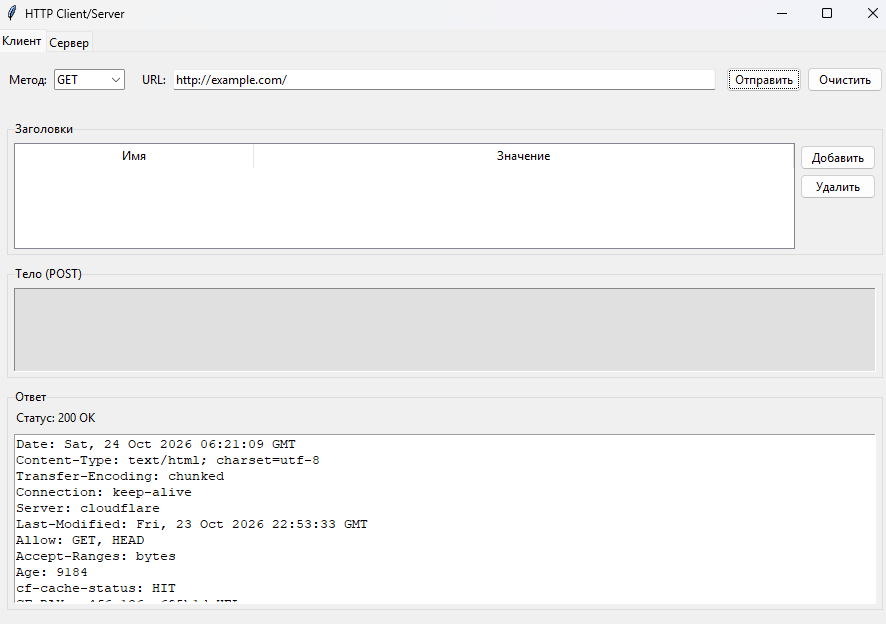

### S2 — Вкладка «Клиент» после POST на /echo

Тело запроса и эхо в ответе.

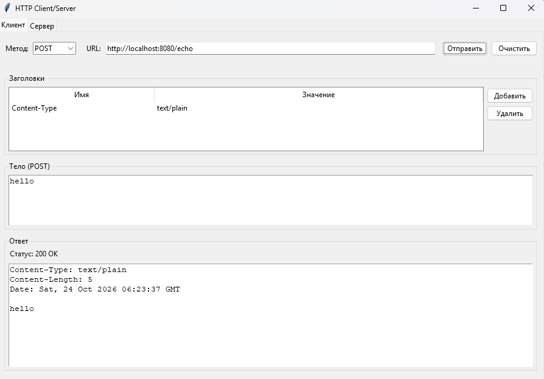

### S3 — Вкладка «Клиент» с ошибкой (неверный URL)

Сообщение об ошибке в области ответа.

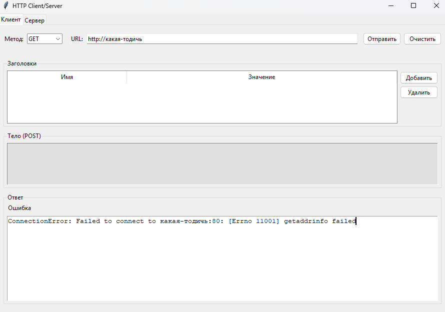

### S4 — Вкладка «Сервер» запущена

Зелёный индикатор, порт 8080.

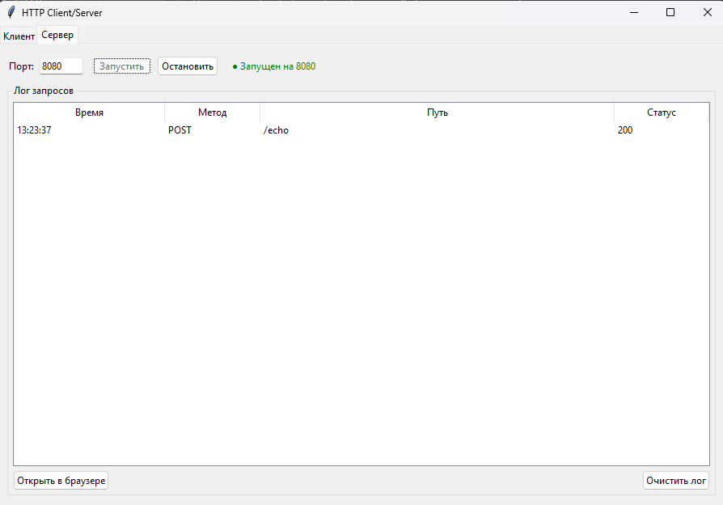

### S5 — curl -v http://localhost:8080/ в терминале

Запрос и ответ, лог в GUI обновился.

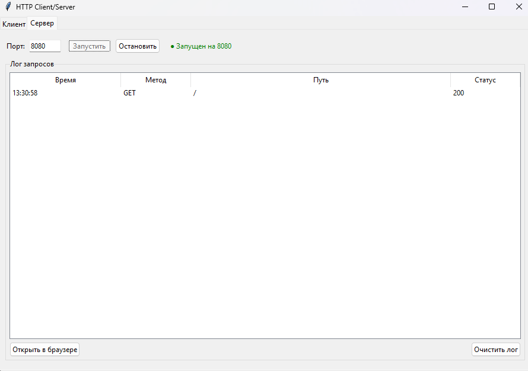

### S6 — curl -X POST -d "hello" .../echo

Эхо «hello».

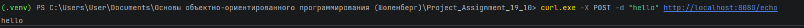

### S7 — curl .../status/418

Статус 418.

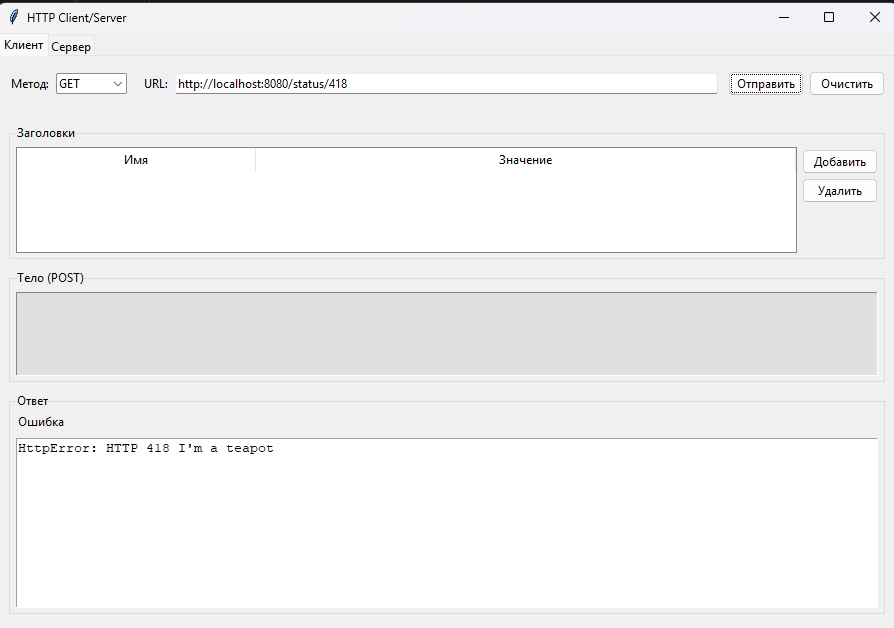

### S8 — curl .../nonexistent

Статус 404.

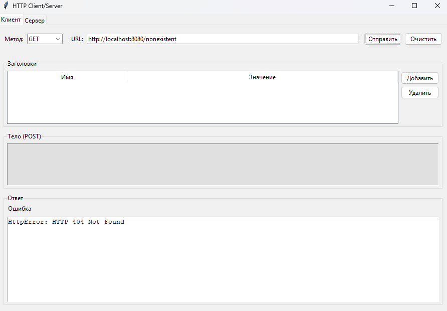

### S9 — Лог сервера с 10 запросами

Метод, путь, статус, время.

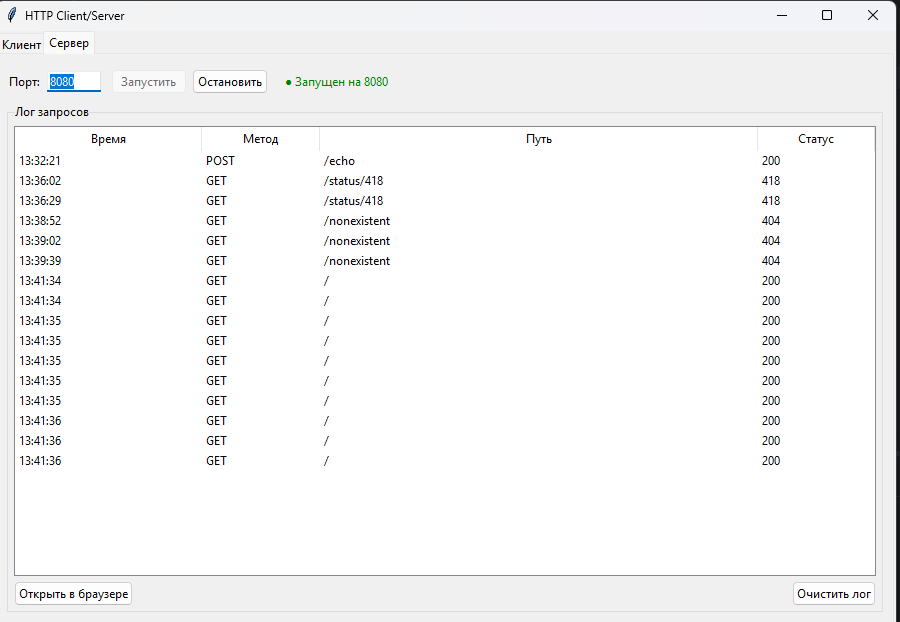

### S10 — pytest tests/ -v

Все тесты PASSED.

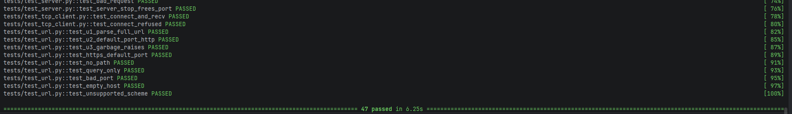

### S11 — flake8 src/ tests/

Нет ошибок.

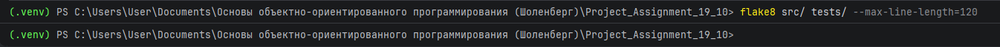

### S12 — 100 параллельных запросов к серверу

Все 200, GUI жив.

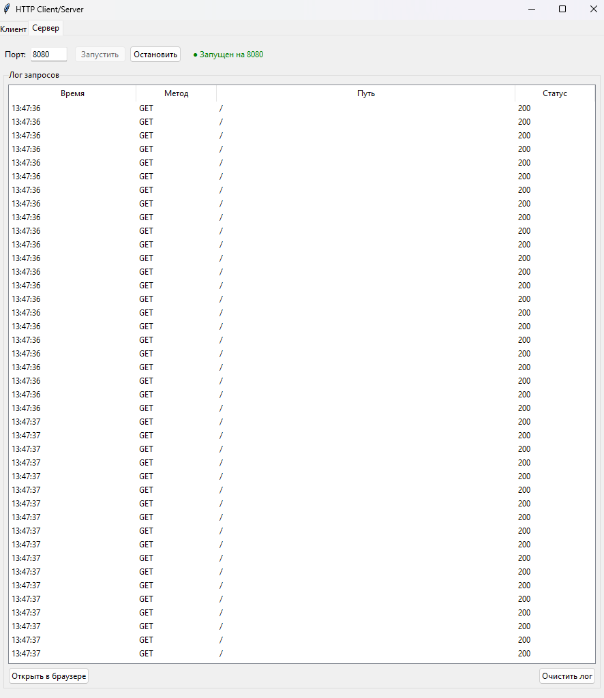

### S13 — Диаграмма классов

Архитектура (нарисована в draw.io).

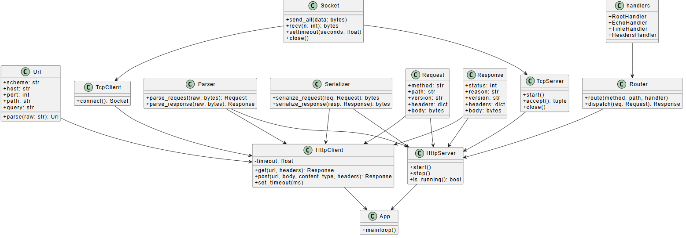